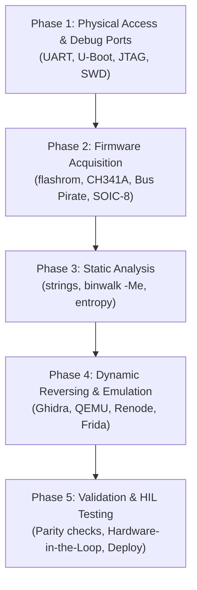

# OdissRea: Operations Manual for Digital Repair in Caveman Ultra Style

## 0. OPERATIONAL CONTEXT: ABANDONMENT, PRACTICAL HACKING & THE ANYTHINK PRINCIPLE

### A. ABANDONMENT
- **Definition**: Hardware/software where vendor ceased all official support.
- **Consequence**: Zero security patches, rapid obsolescence, loss of essential functions, runaway e-waste.
- **Remedy**: Community repair and firmware reconstruction. Not hobby: critical for operational continuity, sustainability, industrial infrastructure.

### B. PRACTICAL HACKING (WHITE-HAT HARDWARE/SOFTWARE REVERSING)
- **Ethos**: Rigorous exploration of physical devices to uncover internal mechanics without official docs.
- **Goal**: Restore, upgrade, patch, achieve interoperability.
- **Toolchain**:
  - Debug ports: UART, JTAG, SWD, SPI.
  - Flash dump: SOIC-8 clip, hot-air desolder, external programmer (CH341A, Bus Pirate, FT232H), `flashrom`.
  - Static triage: `strings`, `binwalk`, entropy graphs (`binwalk -E`).
  - Decompilation & Modernization: Ghidra, IDA Pro, Rizin, REA 207-tool arsenal.
  - Runtime & Emulation: QEMU, Renode, Frida, HIL (Hardware-in-the-Loop).

### C. THE "ANYTHINK" PRINCIPLE (UNIVERSAL INTEROPERABILITY ETHOS)
- **Concept**: Not proprietary brand or simulation gimmick. "Anythink" = "Whatever you think/need to make it work".
- **Rule**: Universal, open, pragmatic problem-solving across any vendor lock-in, OS, architecture, or protocol barrier. Think outside box, outside OS.

---

## 1. RIGHT TO REPAIR FOUNDATION & LEGAL SAFE HARBOR
- **Core Axiom**: *"If you can't fix it, you don't own it."*
- **Legal Framework**:
  - **EU Directive 2009/24/EC Art. 5(1) & 6**: Right to error correction, maintenance, and interoperability without vendor consent (CJEU *Top System* C-13/20, *SAS Institute* C-406/10).
  - **US Copyright Office & FTC Findings**: Exemption under 17 U.S.C. § 1201(f) & § 107 for repair, security audit, and interoperability. FTC confirms zero empirical link between independent repair and safety risks.
  - **State Right-to-Repair Acts**: California, Minnesota (Digital Fair Repair Act), New York, Colorado mandates parts, manuals, schematics, and diagnostic tooling access.

---

## 2. STANDARD 5-PHASE FIRMWARE REVERSE ENGINEERING PIPELINE



### PHASE 1: PHYSICAL ACCESS & DEBUG PORTS
1. Inspect PCB traces under magnifier. Identify unpopulated pin headers or test pads.
2. Probe UART pads (TX, RX, GND) with multimeter / logic analyzer.
3. Attach USB-to-TTL adapter (FT232H / CP2102). Set baud rate (115200 default, step through 9600-115200).
4. Capture boot log. Interrupt boot sequence to catch **U-Boot shell**.
5. Inside U-Boot:
   ```bash
   printenv            # inspect bootcmd, bootargs, memory addresses
   md.b <addr> <len>   # inspect memory
   sf probe 0          # initialize SPI flash
   ```

### PHASE 2: FIRMWARE ACQUISITION
1. If debug ports disabled or locked: target SPI NOR / NAND flash chip (e.g. Winbond W25Q128).
2. Attach 3.3V SOIC-8 test clip or desolder with hot air station (350°C).
3. Connect CH341A / Bus Pirate to host PC.
4. Dump firmware with `flashrom`:
   ```bash
   flashrom -p ch341a_spi -r firmware_dump1.bin
   flashrom -p ch341a_spi -r firmware_dump2.bin
   cmp firmware_dump1.bin firmware_dump2.bin   # verify bit-identical dump
   ```

### PHASE 3: STATIC ANALYSIS
1. Run file and strings scan:
   ```bash
   file firmware_dump.bin
   strings -n 10 firmware_dump.bin | grep -Ei "admin|pass|root|http|token|key|boot"
   ```
2. Scan entropy and extract filesystems:
   ```bash
   binwalk -E firmware_dump.bin               # high entropy = compressed/encrypted
   binwalk -Me firmware_dump.bin              # recursive unpack (SquashFS, CramFS, JFFS2, Ext4)
   ```
3. Inspect unpacked rootfs: check `/etc/shadow`, `/etc/passwd`, `/etc/init.d/`, nvram binaries, web server CGI handlers.

### PHASE 4: DYNAMIC REVERSING & EMULATION
1. Load target binaries into **Ghidra / IDA Pro / Rizin** via OdissRea pantheon (`atena`, `proteo`, `ea`).
2. Identify CPU architecture (ARM, MIPS, PowerPC, RISC-V), endianness (LE/BE), and base load address.
3. Trace critical dispatchers, authentication routines (`strcmp`, crypt hashes), firmware update checkers.
4. **Emulation**:
   - Run system in **QEMU**:
     ```bash
     qemu-system-mips -M malta -kernel vmlinux -drive file=rootfs.ext4,format=raw -append "root=/dev/sda console=ttyS0"
     ```
   - User-space binary emulation:
     ```bash
     qemu-arm-static -L ./extracted_rootfs ./extracted_rootfs/bin/busybox
     ```
   - Board-level simulation in **Renode** for bare-metal ARM Cortex-M microcontrollers.
   - Dynamic tracing via **Frida** (`call_mcp_tool(ServerName="rea", ToolName="instrument_with_frida")`).

### PHASE 5: VALIDATION, HARDWARE-IN-THE-LOOP (HIL) & DEPLOY
1. Test patched binaries or rebuilt images in virtual sandbox first.
2. For industrial/embedded controllers: run HIL test rig with simulated sensors (Arduino/RP2040) before hardware flashing.
3. Repack rootfs (`mksquashfs`, `mkimage`) and flash via U-Boot TFTP or external programmer.

---

## 3. REAL-WORLD CAVE-MAN MISSIONS (THE ANYTHINK ACTION QUESTS)

### MISSION 1: MIKROTIK mAP2n ROUTER — RESTORE SSH ACCESS ON ORPHANED BOX
- **PROBLEM**: Abandoned router. Vendor firmware outdated. Wi-Fi dead. No SSH access.
- **ACTION**:
  1. Open case. Locate UART pads on PCB.
  2. Solder wires to TX/RX/GND. Connect FTDI adapter at 115200 baud.
  3. Power on. Hit spacebar inside 2s window. Drop into U-Boot prompt.
  4. Inspect environment: `printenv bootcmd`.
  5. Dump SPI flash to RAM: `sf probe 0 && sf read 0x80600000 0x0 0x1000000`.
  6. Dump memory to host via serial or network TFTP. Save `router.bin`.
  7. Unpack: `binwalk -Me router.bin`. Locate extracted rootfs.
  8. Inject modern SSH public key into `/etc/dropbear/authorized_keys` or `/root/.ssh/authorized_keys`.
  9. Repack rootfs or build fresh mainline OpenWrt image via ImageBuilder.
  10. Load new image to RAM via TFTP: `tftpboot 0x80600000 openwrt-ramips.bin`. Boot and commit to flash.
- **RESULT**: Orphaned router resurrected. Clean SSH access restored. Zero e-waste.

### MISSION 2: TP-LINK TL-WR340GD — BYPASS HARDCODED ADMIN PASSWORD
- **PROBLEM**: No accessible serial console. Web interface locked with forgotten/leaked hardcoded password.
- **ACTION**:
  1. Identify Atheros SoC + Winbond W25Q128 SPI NOR flash chip.
  2. Desolder SPI chip with hot-air pencil (350°C).
  3. Seat chip into CH341A programmer socket. Read with `flashrom -p ch341a_spi -r firmware.bin`.
  4. Run `strings -n 16 firmware.bin | grep "TP-LINK"`.
  5. Locate hardcoded administrative credentials in web daemon string table.
  6. Load HTTP daemon binary into Ghidra via `atena`.
  7. Find function calling `strcmp` on input credentials.
  8. Patch instruction: invert conditional jump or set return register `R0=0` (success).
  9. Repack SquashFS with `mksquashfs`. Splice patched filesystem into firmware image.
  10. Flash patched image back to SPI chip with `flashrom`. Resolder chip to PCB.
- **RESULT**: Root web access regained. Security flaw removed. Device operational.

### MISSION 3: INDUSTRIAL PLC CONTROLLER — EXTEND LIFESPAN OF CRITICAL SYSTEM
- **PROBLEM**: Legacy factory PLC controller. Vendor obsolete. Replacement costs $50,000 + recertification downtime.
- **ACTION**:
  1. Hook Saleae Logic Analyzer to internal SPI bus lines between CPU and EEPROM.
  2. Record communication frames during boot and sensor read cycles.
  3. Load extracted binary into Renode simulator. Map MMIO registers.
  4. Add debug hooks to sensor acquisition procedures.
  5. Reverse engineer sensor curve calibration formula.
  6. Patch PLC firmware to read new digital sensor calibration tables from unused EEPROM offsets.
  7. Test patched firmware in Hardware-in-the-Loop (HIL) rig with microcontroller generating synthetic sensor loads.
  8. Flash verified patch back to physical controller flash.
- **RESULT**: Machine lifecycle extended by 10+ years. $50k capital expense avoided. Safety certifications intact.

### MISSION 4: FITNESS TRACKER (BRAND X) — LIBERATE DATA TO SELF-HOSTED API
- **PROBLEM**: Proprietary wearable. Cloud service shut down. Tracker useless without vendor servers.
- **ACTION**:
  1. Sniff Bluetooth Low Energy (BLE) advertisements and GATT services using Wireshark + nRF Sniffer.
  2. Reverse engineer Android companion APK using OdissRea `scheria` (`inspect_android_package`, `decompile_jeb_item`).
  3. Locate AES session key derivation inside native JNI library (`libtracker.so`).
  4. Write standalone Python daemon with `bleak` library to emulate companion app handshake.
  5. Decrypt binary GATT notifications. Parse heart rate, step count, accelerometer frames.
  6. Push decoded metrics to local InfluxDB / Home Assistant instance.
- **RESULT**: Cloud dependency severed. Device operational locally. Privacy guaranteed.

### MISSION 5: SMART HOME LIGHT BULB — LOCAL OTA & SECURITY HARDENING
- **PROBLEM**: Smart IoT bulb connects to vulnerable cloud update server. Firm shutdown leaves bulb exposed.
- **ACTION**:
  1. Intercept outbound firmware check via `mitmproxy`.
  2. Capture signed OTA package. Extract payload (tar archive with SquashFS).
  3. Decompress rootfs. Locate updater init script.
  4. Patch script to disable cloud TLS signature enforcement or inject custom local CA certificate.
  5. Repack rootfs. Flash patched firmware via UART header.
  6. Reconfigure device to point to internal LAN OTA server (e.g. MQTT / ESPHome).
- **RESULT**: Zombie network threat eliminated. Bulb managed locally. Complete owner control.

---

## 4. ADVANCED STRATEGIES & OPERATIONAL IMPACT MAPPING
- **Never stop at "flaw found"**: Map every technical finding (unlocked bootloader, memory leak, hardcoded key, unauthenticated port) directly to **operational impact** (firmware dump possible, local control restored, device firewall rule synthesized).
- **Clean-Room Boundary**: When authoring new drivers or open-source ports, pass findings through `ermes` (`CLEAN_SPEC.md`) so new source code is 100% original, immune to copyright challenges, and clean-room compliant.
- **Autonomous Convergence**: Use `/goal` loop across OdissRea skills until parity check passes (`coverage == 100%`, `unknowns == 0`).
