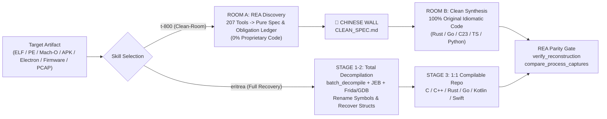

# 🦾 CYBERDYNE-REA :: `t-800` & `eritrea`

> **Ultra-Dense Caveman (`ultracave`) Agent Skills for the 207-Tool [REA (Reverse Engineer Anything)](https://github.com/morluto/rea) MCP Arsenal.**
> Built for **Antigravity (AGY)**, **Claude Code**, **Gemini CLI**, **OpenCode**, **Codex**, and **Cursor**.

---

## ⚡ Overview

`cyberdyne-rea` equips AI coding agents with two complementary, hyper-compressed (`ultracave` token-optimized) operational skills that orchestrate all **207 MCP tools** of **REA**:

| Skill | Codename | Operational Mode | Legal / Architectural Frame | Best For |
| :--- | :--- | :--- | :--- | :--- |
| **[`t-800`](skills/t-800/SKILL.md)** | *Cyberdyne Systems Model 101* | **Two-Room Chinese Wall (Clean-Room)** | EU Dir. 2009/24/EC Art. 5(1), 5(3), Art. 6 · CJEU *SAS Institute* (C-406/10) & *Top System* (C-13/20) | Commercial/open-source re-implementation from scratch, legacy/EOL modernization, protocol/DB interoperability without proprietary code contamination |
| **[`eritrea`](skills/eritrea/SKILL.md)** | *Sovereign Zero-Barrier Recovery* | **Unconstrained 1:1 Source Recovery** | First-Party Orphaned Binary / Lost-Source Recovery + Non-Berne/Non-TRIPS Sovereign Scope | Recovering lost source trees of your own binaries, full decompilation (`batch_decompile`, JEB, Ghidra, IDA), struct/vtable recovery, Frida/GDB live instrumentation |

---

## 🧠 Architecture



---

## 🚀 Quick Install

### One-Liner (Antigravity / Gemini CLI / Claude Code / OpenCode)
```bash
git clone https://github.com/mich-de/cyberdyne-rea.git && cd cyberdyne-rea && ./install.sh
```

### Manual Copy
```bash
# Antigravity / Gemini CLI
cp -r skills/t-800 skills/eritrea ~/.gemini/config/skills/

# Claude Code
cp -r skills/t-800 skills/eritrea ~/.claude/skills/

# OpenCode
cp -r skills/t-800 skills/eritrea ~/.config/opencode/skills/
```

---

## 🛠️ Full 207-Tool REA Coverage

Both skills include deterministic routing across every REA domain:
- **Native Static & Decompilers**: Ghidra, IDA Pro, Hopper, Rizin, Cutter, Objdump (`open_binary`, `batch_decompile`, `procedure_pseudo_code`, `get_call_graph`, `trace_native_values`, `inspect_native_dispatch_metadata`).
- **Platform Specialists**: Go (`inspect_go_binary`), Rust (`inspect_rust_binary`), Swift/ObjC (`analyze_swift_types`, `get_objc_classes`), .NET/CLI/NativeAOT (`inspect_managed_artifact`, `inspect_managed_native_boundaries`).
- **Mobile & Embedded**: Android APK/DEX/JEB/Apktool (`inspect_android_package`, `decompile_jeb_item`), Flutter/Dart AOT (`identify_flutter_build`, `inspect_dart_aot`), HarmonyOS, Firmware (`inspect_firmware_regions`, `extract_firmware`), Logic/Bus Signals (`decode_signal_recording`).
- **Web, Electron, WASM & EVM**: `analyze_javascript_application`, `recover_javascript_sources`, `inspect_electron_fuses`, `inspect_wasm_artifact`, `inspect_evm_interface`.
- **Dynamic Runtime & Traffic**: Frida (`instrument_with_frida`), GDB (`start_gdb_session`), Rizin Debug, ADB (`list_adb_devices`, `pull_adb_package`, `read_adb_logcat`), Process/Browser/Electron Scenarios, HAR/SAZ/PCAP/qlog (`inspect_web_network_capture`, `inspect_pcap_capture`, `inspect_packet_capture`), SQLite (`inspect_sqlite_database`).
- **Verification & Parity**: `build_reconstruction_obligation_ledger`, `evaluate_reconstruction_coverage`, `verify_reconstruction`, `compare_functions`, `compare_process_captures`.

---

## 📄 License

MIT © [mich-de](https://github.com/mich-de)
