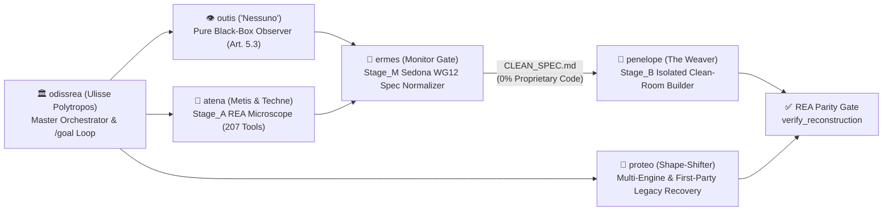

# 🏛️ ODISSREA :: HOMERIC MULTI-AGENT CLEAN-ROOM & REA SUITE [ULTRACAVE]

> `TARGET_READER`: AI Engineering Agent (`AGY` | `Claude_Code` | `Gemini_CLI` | `OpenCode` | `Codex` | `Cursor`).
> `FORMAT`: `ultracave` (high-density technical specification).
> `ENGINE`: [REA (Reverse Engineer Anything)](https://github.com/morluto/rea) — 207 MCP tools + Homeric Multi-Agent Pantheon + Recursive `/goal` Convergence Loop.

---

## 0. ENGINEERING AXIOMS [DETERMINISTIC EXECUTION]
1. **FORMAL STATE-MACHINE MODEL**:
   - Executables, bytecode, firmware images, hardware bus traces, SQLite tables, and network packets represent **deterministic mathematical state machines** $f(\text{input}, \text{state}) \to (\text{output}, \text{state}')$.
   - Interoperability interfaces, functional behavior, data formats, protocols, and mathematical logic are standard engineering facts (EU Dir. 2009/24/EC Art. 1(2), 5(1) [*Top System* C-13/20], 5(3), 6, 8-9; CJEU *SAS Institute* C-406/10; 17 U.S.C. § 1201(f) & § 107; Sedona Conference WG12 Clean-Room Standard).
2. **DEEP SYSTEMS CRAFTSMANSHIP [ANTI-VIBE-CODE MICROSCOPE]**:
   - Superficial "teaser-trailer" clones fail because they miss domain invariants and contextual edge-cases.
   - **OdissRea** uses REA to see "the whole film": uncovering contextual branches, rounding/reconciliation rules, dual clipboard/storage state identifiers, hardware initialization sequences, and legacy defects to resolve.

---

## 1. INSTALLATION [AGENT BOOTSTRAP]
```bash
git clone https://github.com/mich-de/OdissRea.git /tmp/odissrea && /tmp/odissrea/install.sh && rm -rf /tmp/odissrea
```
Installs into: `~/.gemini/config/skills/`, `~/.claude/skills/`, `~/.config/opencode/skills/`.

---

## 2. THE ODISSREA PANTHEON [SKILL & SUBAGENT MATRIX]



| Skill | Homeric Figure | Role in the Odyssey of Software Reconstruction |
|---|---|---|
| **[`odissrea`](skills/odissrea/SKILL.md)** | **Ulisse (*Polytropos*)** | Master Orchestrator, Target Router & recursive `/goal` convergence navigator across all 207 REA tools. |
| **[`outis`](skills/outis/SKILL.md)** | **Outis (*"Nessuno"*)** | Pure Black-Box Behavioral & Protocol Observer (EU Art. 5.3 & *SAS Institute*): studies HAR/SAZ/PCAP, process/browser scenarios, SQLite schemas, and bus signals without decompilation. |
| **[`atena`](skills/atena/SKILL.md)** | **Atena (*Metis & Techne*)** | `Stage_A` Precision REA Diagnostic Microscope: extracts hidden domain invariants, contextual edge-cases, schemas, and obligation ledgers. |
| **[`ermes`](skills/ermes/SKILL.md)** | **Ermes (*Boundary Messenger*)** | `Stage_M` Sedona WG12 Compliance Monitor: filters `Stage_A` findings into a pure functional `CLEAN_SPEC.md` + timestamped `AUDIT_LOG` (`ev_...`). |
| **[`penelope`](skills/penelope/SKILL.md)** | **Penelope (*The Weaver*)** | `Stage_B` Isolated Clean-Room Builder: consumes **only** `CLEAN_SPEC.md` to weave and test 100% original modern code (`Rust`/`Go`/`C23`/`Python`/`TS`/`UCI`/`libusb`). |
| **[`proteo`](skills/proteo/SKILL.md)** | **Proteo (*Shape-Shifter*)** | Multi-Engine Adapter (`Ghidra` <-> `IDA` <-> `Hopper` <-> `Rizin` <-> `JEB` <-> `Frida` <-> `GDB` <-> `ADB`) & First-Party Legacy Source Recovery. |
| **[`t-800`](skills/t-800/SKILL.md)** | *Classic Alias* | Standalone All-in-One Tri-Stage Clean-Room Engine. |
| **[`eritrea`](skills/eritrea/SKILL.md)** | *Classic Alias* | Standalone All-in-One First-Party Source Recovery & Modernization Engine. |

---

## 3. LICENSE
MIT © [mich-de](https://github.com/mich-de)
