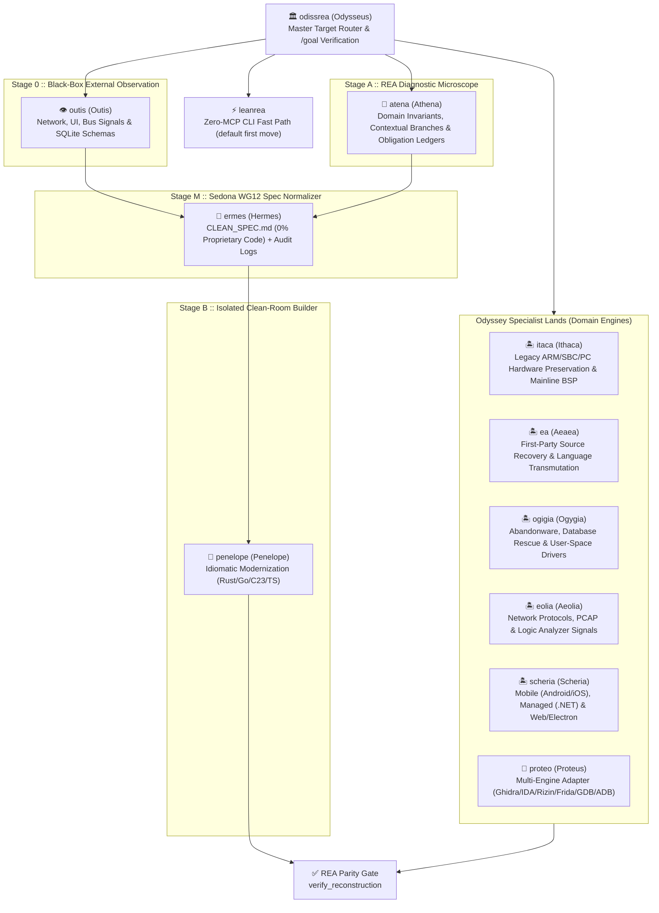
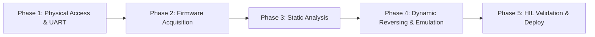

# 🏛️ OdissRea — Universal Digital Repair & Clean-Room Modernization Manual for REA

> `FORMAT`: `ultracave` (high-density, zero-fluff technical specification).  
> `ENGINE`: [REA (Reverse Engineer Anything)](https://github.com/morluto/rea) — 207 MCP tools across Native, Managed, Mobile, Web/Electron, WASM/EVM, Firmware, Databases, and Network Protocols.  
> `ETHOS`: **Anythink** — Universal Pragmatic Interoperability & Right-to-Repair across any vendor lock-in, OS, architecture, or protocol barrier. Think outside box, outside OS.

---

## 0. OPERATIONAL CONTEXT: ABANDONMENT, PRACTICAL HACKING & THE ANYTHINK PRINCIPLE

### A. THE ABANDONMENT CRISIS
- **Definition**: Devices, firmware, and software where original vendor terminated official support.
- **Consequences**: Zero security updates, arbitrary cloud shutdowns, artificial hardware bricking, escalating electronic waste (e-waste).
- **Remedy**: Independent technical repair, reverse engineering, and clean-room firmware reconstruction. Essential for industrial infrastructure continuity, digital sovereignty, and ecological sustainability.

### B. PRACTICAL HACKING (WHITE-HAT HARDWARE/SOFTWARE REVERSING)
- **Methodology**: Action-oriented, non-destructive exploration of physical hardware and compiled binaries without official documentation.
- **Objectives**: Diagnose defects, restore lost access, extract hardware descriptors, synthesize open-source drivers, and modernize software stacks.
- **Core Arsenal**:
  - Hardware buses & debug headers: UART, JTAG, SWD, SPI, I2C.
  - Memory extraction: In-circuit SOIC-8 test clips, hot-air desoldering, SPI/NAND programmers (CH341A, FT232H, Bus Pirate), `flashrom`.
  - Static triage: `strings`, `binwalk`, entropy mapping (`binwalk -E`).
  - Disassembly & Decompilation: Ghidra, IDA Pro, Rizin, Cutter, REA 207-tool MCP server.
  - Dynamic instrumentation & testing: QEMU architecture emulation, Renode board simulation, Frida runtime hooking, Hardware-in-the-Loop (HIL) testbeds.

### C. THE "ANYTHINK" PRINCIPLE (UNIVERSAL INTEROPERABILITY ETHOS)
- **Meaning**: "Whatever you think / need to make it work".
- **Rule**: Not bound to single vendor, OS, or architecture. Open, universal problem-solving ethos: if hardware exists and physics permits, software can be adapted, repaired, and liberated.

---

## 1. LEGAL FOUNDATION & RIGHT TO REPAIR SAFE HARBOR

- **Core Axiom**: *"If you can't fix it, you don't own it."*
- **EU Statutory Safe Harbor**:
  - **Directive 2009/24/EC Art. 5(1)**: Error correction, reproduction, and maintenance by lawful acquirers without vendor authorization (CJEU *Top System* C-13/20).
  - **Directive 2009/24/EC Art. 5(3)**: Right to observe, study, and test program functionality to determine underlying principles (CJEU *SAS Institute* C-406/10 — formats, protocols, and interfaces are not copyrightable).
  - **Directive 2009/24/EC Art. 6**: Decompilation strictly permitted to achieve interoperability with independently created software.
- **US Federal & State Law**:
  - **17 U.S.C. § 1201(f) & § 107**: Statutory exemptions for reverse engineering for interoperability and fair-use security research.
  - **US FTC Findings (Nixing the Fix)**: Zero empirical basis linking independent repair to compromised safety or security.
  - **State Digital Fair Repair Acts**: Minnesota, California, New York, Colorado mandates to provide diagnostics, firmware updates, and repair tooling.
- **Sedona Conference WG12**: Formal Clean-Room methodology ensures reconstructed software retains 0% proprietary code expression while maintaining 100% functional interoperability.

---

## 2. THE ODISSREA PANTHEON [UNIVERSAL MULTI-AGENT ARCHITECTURE]



| Skill | Classical Archetype | Universal Engineering Scope |
|---|---|---|
| **[`odissrea`](skills/odissrea/SKILL.md)** | **Odysseus (*Polytropos*)** | Master Orchestrator, universal target router across all 207 REA tools, and iterative `/goal` verification coordinator. |
| **[`leanrea`](skills/leanrea/SKILL.md)** | *Zero-MCP Fast Path* | Default first move: plain Bash/CLI tools (`file`, `readelf`/`otool`, `nm`, `strings`, `jq`, `rg -uu`, `go version -m`, `sqlite3`, `tshark`, `binwalk`) route and inventory any target in 2-4 turns. Escalates to the MCP lands only on a real gap. Distilled from [leanrea](https://github.com/aicodeking/leanrea) (MIT), adapted to Linux-native tooling. |
| **[`outis`](skills/outis/SKILL.md)** | **Outis (*External Observer*)** | `Stage_0` Black-Box Behavioral & Protocol Analyst: inspects HTTP/HAR/SAZ/PCAP, CLI/UI scenarios, SQLite schemas, and logic signals without decompilation. |
| **[`atena`](skills/atena/SKILL.md)** | **Athena (*Metis & Techne*)** | `Stage_A` REA Diagnostic Microscope: extracts hidden domain invariants, contextual edge-cases, data schemas, and formal obligation ledgers (`build_reconstruction_obligation_ledger`). |
| **[`ermes`](skills/ermes/SKILL.md)** | **Hermes (*Boundary Monitor*)** | `Stage_M` Sedona WG12 Specification Gate: normalizes `Stage_A` findings into pure functional `CLEAN_SPEC.md` + timestamped `AUDIT_LOG` (`ev_...`) with zero proprietary code expression. |
| **[`penelope`](skills/penelope/SKILL.md)** | **Penelope (*The Weaver*)** | `Stage_B` Isolated Clean-Room Builder: consumes **only** `CLEAN_SPEC.md` to architect and test 100% original code (`Rust`, `Go`, `C23`, `Zig`, `Python`, `TS`, `Swift`, `Kotlin`, `UCI`, `libusb`). |
| **[`proteo`](skills/proteo/SKILL.md)** | **Proteus (*Multi-Engine*)** | Multi-Engine Adapter (`Ghidra` <-> `IDA` <-> `Hopper` <-> `Rizin` <-> `JEB` <-> `Frida` <-> `GDB` <-> `ADB`) & First-Party Legacy Source Recovery. |
| **[`itaca`](skills/itaca/SKILL.md)** | **Ithaca (*Homeland Hardware*)** | Legacy ARM, Mobile, SBC & PC Hardware Preservation: DTB/DTS reconstruction, vendor `.ko`/HAL interoperability, and mainline Linux/postmarketOS/LineageOS porting. |
| **[`ea`](skills/ea/SKILL.md)** | **Aeaea (*Transmutation Island*)** | First-Party Source Recovery & Cross-Language Transmutation: decompile and translate owned C/C++/ASM binaries into modern `Rust`, `Go`, `C23`, or `TypeScript`. |
| **[`ogigia`](skills/ogigia/SKILL.md)** | **Ogygia (*Orphaned Systems*)** | Abandonware, Database & Peripheral Rescue: recover SQLite schemas, crash dumps, proprietary archives, and synthesize user-space drivers (`libusb`/`hidapi`). |
| **[`eolia`](skills/eolia/SKILL.md)** | **Aeolia (*Winds & Flows*)** | Network Protocol, Packet (`PCAP`/`HAR`/`SAZ`/`qlog`) & Hardware Bus Signal (`UART`/`SPI`/`I2C`/`USB`) Interoperability Analysis. |
| **[`scheria`](skills/scheria/SKILL.md)** | **Scheria (*Phaeacian Port*)** | Mobile (`Android APK`/`DEX`/`Flutter`, `Apple IPA`/`Swift`), Managed (`.NET`), and `Electron`/`Web`/`WASM` Application Graph Modernization. |
| **[`t-800`](skills/t-800/SKILL.md)** | *Standalone Clean-Room* | All-in-One Tri-Stage Clean-Room Specification & Modernization Engine. |
| **[`eritrea`](skills/eritrea/SKILL.md)** | *Standalone Recovery* | All-in-One First-Party Legacy Source Recovery & Modernization Engine. |

---

## 3. INSTALLATION
```bash
git clone https://github.com/mich-de/OdissRea.git /tmp/odissrea && /tmp/odissrea/install.sh && rm -rf /tmp/odissrea
```
Target directories automatically populated:
- `~/.gemini/config/skills/`
- `~/.claude/skills/`
- `~/.config/opencode/skills/`

---

## 4. STANDARD 5-PHASE FIRMWARE & HARDWARE REVERSE ENGINEERING PIPELINE



### PHASE 1 :: PHYSICAL ACCESS & DEBUG HEADERS
1. Visually inspect PCB under microscope/magnifier for unpopulated 3-pin or 4-pin headers and test pads.
2. Probe pads with digital multimeter (continuity test to ground for GND, identify TX with fluctuating voltage on boot, RX high impedance, VCC steady 3.3V/5V — DO NOT connect VCC to USB serial adapter).
3. Connect 3.3V USB-to-TTL adapter (FTDI FT232H / CP2102). Set serial parameters (default `115200 8N1`, try `57600`, `38400`, `9600`).
4. Read boot log. Send keystroke (Space / Enter / `Ctrl+C`) during boot countdown to drop into **U-Boot shell**.
5. Inside U-Boot:
   ```bash
   printenv            # inspect bootcmd, bootargs, load addresses
   md.b <addr> <len>   # inspect memory contents
   sf probe 0          # initialize SPI flash
   ```

### PHASE 2 :: FIRMWARE ACQUISITION
1. If serial disabled or locked: locate SPI NOR/NAND flash (e.g. Winbond W25Q128, Macronix MX25L).
2. Attach 3.3V SOIC-8 clip directly to chip in-circuit. If pull-up resistors cause bus contention, desolder chip using hot-air rework station (350°C).
3. Connect to CH341A / Bus Pirate / FT232H programmer.
4. Dump full flash image with `flashrom`:
   ```bash
   flashrom -p ch341a_spi -r dump1.bin
   flashrom -p ch341a_spi -r dump2.bin
   cmp dump1.bin dump2.bin   # ensure byte-perfect parity
   ```

### PHASE 3 :: STATIC ANALYSIS & EXTRACTION
1. Scan strings, file headers, and certificates:
   ```bash
   file dump1.bin
   strings -n 10 dump1.bin | grep -Ei "admin|root|password|http|dropbear|secret|board"
   ```
2. Measure entropy and extract filesystems:
   ```bash
   binwalk -E dump1.bin      # high entropy = compressed/encrypted; low = plaintext/code
   binwalk -Me dump1.bin     # recursively unpack SquashFS, CramFS, JFFS2, Ext4, kernel
   ```
3. Inspect unpacked root filesystem: examine `/etc/shadow`, `/etc/passwd`, `/etc/init.d/*`, web server CGI scripts, NVRAM utility binaries.

### PHASE 4 :: DYNAMIC REVERSING, EMULATION & INSTRUMENTATION
1. Load target binaries into Ghidra / IDA Pro / Rizin via OdissRea (`atena`, `proteo`, `ea`).
2. Identify CPU architecture (ARMv7, ARM64, MIPS, RISC-V), endianness, base address.
3. Locate authentication routines, checksum verifiers, firmware update signature checks.
4. **Full-System Emulation**:
   ```bash
   qemu-system-mips -M malta -kernel vmlinux -drive file=rootfs.ext4,format=raw -append "root=/dev/sda console=ttyS0"
   ```
5. **User-Space Emulation**:
   ```bash
   qemu-arm-static -L ./extracted_rootfs ./extracted_rootfs/usr/sbin/httpd
   ```
6. **Simulation**: Use **Renode** for bare-metal microcontroller simulation (Cortex-M) and synthetic sensor feeds.
7. **Runtime Tracing**: Hook procedures via **Frida** (`instrument_with_frida`) or **GDB** (`start_gdb_session`) to log arguments, unpack encrypted payloads, and verify state machines.

### PHASE 5 :: VALIDATION & HARDWARE-IN-THE-LOOP (HIL)
1. Verify patches or modernized firmware in emulator/simulator before flashing physical hardware.
2. For industrial PLCs and safety-critical controllers: execute automated HIL tests with microcontrollers generating synthetic sensor inputs.
3. Rebuild firmware image (`mksquashfs`, `mkimage`) and flash via U-Boot TFTP or external programmer.

---

## 5. THE CAVEMAN WORKBENCH [ESSENTIAL BOM & LAB SETUP]

Bill of Materials for modern digital repair lab. Buy cheap, buy twice. Buy quality, buy once.

- **Vision & Magnification**: Stereo microscope (AmScope / Trinocular), digital USB microscope, adjustable LED ring light.
- **Probing & Logic**: Saleae Logic Pro 16 / DSLogic Plus, Rigol DS1054Z oscilloscope, digital multimeter with audible continuity buzzer.
- **Solder & Rework**: Hakko FX-888D soldering station, 858D hot-air rework station, Chip Quik low-temp removal alloy, tacky flux gel, Kapton high-temperature tape, 99.9% isopropyl alcohol (IPA).
- **Programmers & Adapters**:
  - **CH341A** (with **1.8V adapter module** — CRITICAL for modern 1.8V NAND/NOR flash).
  - **FT232H / FT2232H** breakout boards (high-speed UART/SPI/JTAG/Bitbang).
  - **J-Link / ST-Link V2 / Raspberry Pi** (for OpenOCD SWD/JTAG).
  - **CANable / PCAN-USB** (for automotive/industrial CAN-Bus).
  - **HackRF One / Yard Stick One** (for Sub-GHz / RF analysis).
- **Software Stack**: Linux host (Debian/Ubuntu/Parrot/Kali), `flashrom`, `binwalk`, `Ghidra`, `QEMU`, `Renode`, `Wireshark`, `PlatformIO`, REA MCP server.

---

## 6. ANYTHINK FIELD DIRECTIVES [CAVEMAN ULTRA SURVIVAL GUIDE]

- **Rule 1: Trust No Silicon.** Assume every pin is debug. Probe everything. Multimeter && logic analyzer are primary weapons.
- **Rule 2: Cloud is Lie.** Local control > Vendor cloud. If cloud dead == device dead. Cut cord. Build local bridge.
- **Rule 3: Binary is Truth.** Marketing lies. Code doesn't. Strings dump reveals secrets. Entropy map reveals crypto.
- **Rule 4: Emulate Before Flash.** Bricked hardware == sad caveman. QEMU/Renode first. HIL second. Flash last.
- **Rule 5: Clean-Room is Shield.** Copying code == copyright risk. Copying functional logic == freedom. `ermes` spec -> `penelope` build. Zero IP contamination.
- **Rule 6: Right to Repair is Law.** EU Directive 2009/24/EC && US DMCA 1201(f) are shields. Wield them. Document everything.

---

## 7. REAL-WORLD MISSIONS & ACTION QUESTS [THE 20 ANYTHINK CASE STUDIES]

### MISSION 1: MIKROTIK mAP2n ROUTER — RESTORE SSH ON ABANDONED BOX
- **PROBLEM**: Abandoned router. Vendor firmware obsolete. Wi-Fi dead. No SSH access.
- **ACTION**:
  1. Open casing. Identify UART test pads on PCB.
  2. Solder wires to TX/RX/GND. Connect FTDI adapter at 115200 baud.
  3. Power on. Hit spacebar inside 2s countdown. Enter U-Boot shell.
  4. Inspect environment: `printenv bootcmd`.
  5. Dump SPI flash: `sf probe 0 && sf read 0x80600000 0x0 0x1000000`.
  6. Dump memory to host via TFTP or serial hex dump (`router.bin`).
  7. Unpack: `binwalk -Me router.bin`. Locate rootfs.
  8. Inject modern public SSH key into `/etc/dropbear/authorized_keys`.
  9. Rebuild clean OpenWrt image via ImageBuilder.
  10. Load image via TFTP: `tftpboot 0x80600000 openwrt-ramips.bin`. Flash and reboot.
- **RESULT**: Orphaned router salvaged. Modern SSH access restored. Zero e-waste.

### MISSION 2: TP-LINK TL-WR340GD — BYPASS HARDCODED ADMIN PASSWORD
- **PROBLEM**: No exposed serial shell. Vendor discontinued support. Default admin password leaked/locked.
- **ACTION**:
  1. Identify Atheros SoC + Winbond W25Q128 SPI NOR flash chip.
  2. Desolder SPI chip with hot-air rework station (350°C).
  3. Mount chip into CH341A socket. Run `flashrom -p ch341a_spi -r firmware.bin`.
  4. Run `strings -n 16 firmware.bin | grep "TP-LINK"`.
  5. Locate plaintext administrative credentials in web server string table.
  6. Open HTTP server binary in Ghidra via `atena`.
  7. Find function comparing credentials via `strcmp`.
  8. Patch conditional jump / force return code 0 (success).
  9. Repack rootfs with `mksquashfs`. Splice patched filesystem into firmware binary.
  10. Write patched image back to SPI flash with `flashrom`. Resolder chip to board.
- **RESULT**: Administrative root access restored. Hardcoded password flaw eliminated.

### MISSION 3: INDUSTRIAL PLC CONTROLLER — EXTEND CRITICAL LIFECYCLE
- **PROBLEM**: Legacy factory PLC controller. Vendor defunct. New controller costs $50,000 + recertification downtime.
- **ACTION**:
  1. Connect Saleae Logic Analyzer to internal SPI bus lines between MCU and EEPROM.
  2. Capture transaction frames during power-on and sensor read cycles.
  3. Load PLC binary into Renode simulator. Map MMIO registers.
  4. Hook sensor reading functions to trace calibration calculations.
  5. Modify firmware to accept modern digital sensor calibration values stored in EEPROM.
  6. Run HIL testbed with RP2040 generating simulated sensor voltages.
  7. Flash verified patch back to physical controller.
- **RESULT**: Machine lifespan extended 10+ years. $50k replacement cost avoided. Safety certification maintained.

### MISSION 4: FITNESS TRACKER (BRAND X) — LIBERATE PROPRIETARY DATA TO LOCAL API
- **PROBLEM**: Proprietary wearable. Cloud servers decommissioned. Device unusable without vendor backend.
- **ACTION**:
  1. Sniff Bluetooth Low Energy (BLE) GATT packets with Wireshark + nRF Sniffer.
  2. Decompile companion Android APK with OdissRea `scheria` (`inspect_android_package`, `decompile_jeb_item`).
  3. Extract AES encryption key and session handshake from native library (`libtracker.so`).
  4. Write standalone Python daemon with `bleak` to emulate mobile app BLE handshake.
  5. Decrypt binary GATT notifications. Parse heart rate, step count, and sleep frames.
  6 forward decoded metrics directly to local Home Assistant / InfluxDB instance.
- **RESULT**: Device liberated from defunct cloud. Works 100% locally with zero data leakage.

### MISSION 5: SMART HOME LIGHT BULB — LOCAL OTA & SECURITY HARDENING
- **PROBLEM**: IoT light bulb queries closed cloud update server. Firm shutdown leaves bulb exposed to network attacks.
- **ACTION**:
  1. Intercept outbound firmware check with `mitmproxy`.
  2. Capture signed update payload. Extract archive (tar containing SquashFS).
  3. Unpack SquashFS. Locate update verification script.
  4. Patch script to disable cloud TLS signature enforcement or trust internal root CA.
  5. Repack rootfs. Flash patched firmware via UART test header.
  6. Reconfigure device to point to internal LAN OTA server (ESPHome / local MQTT broker).
- **RESULT**: Network vulnerability closed. Bulb managed entirely on private LAN.

### MISSION 6: ABANDONWARE ARM SMARTPHONE / SBC -> MAINLINE LINUX (`itaca`)
- **PROBLEM**: EoL ARMv7/AArch64 phone or SBC stuck on vendor Android 5/6 (kernel 3.4/3.10); vendor dropped support.
- **ACTION**:
  1. `inspect_firmware_regions` -> `extract_firmware` (`boot.img`, `vendor.img`, `dtbo.img`, `super.img`).
  2. Extract `/sys/firmware/fdt` or `boot.img` DTB -> `dtc -I dtb -O dts -o board.dts`.
  3. `open_binary` on vendor `.ko` modules & `hardware/*.so` -> `batch_decompile`, `inspect_native_data_type`. Recover MMIO base addresses, GIC interrupts, pinctrl states, regmap sequences, PMIC voltage rails, MIPI-DSI panel timings.
  4. `list_adb_devices` -> `pull_adb_file` (`/proc/iomem`, `/proc/interrupts`, `/sys/kernel/debug/clk/clk_summary`, `/sys/kernel/debug/gpio`).
  5. `build_reconstruction_obligation_ledger` -> synthesize clean mainline `.dts`/`.dtsi`, U-Boot defconfig, `postmarketOS` APKBUILD or `LineageOS` device tree -> `verify_reconstruction`.
- **RESULT**: Phone runs modern mainline Linux 6.x / postmarketOS with upstream security patches.

### MISSION 7: ORPHANED USB / SERIAL PERIPHERAL -> USER-SPACE DRIVER (`ogigia` + `eolia`)
- **PROBLEM**: Scientific instrument, audio interface, or industrial scanner only has 32-bit Windows XP/7 `.sys` driver; modern OS blocks unsigned/legacy kernel driver.
- **ACTION**:
  1. `open_binary` on legacy `.sys`/`.dll` -> `list_procedures`, `find_xrefs_to_name` (`IoCallDriver`, `UsbBuildInterruptOrBulkTransferRequest`, `DeviceIoControl`).
  2. `procedure_pseudo_code` + `inspect_native_data_type` -> extract USB control transfers (`bmRequestType`, `bRequest`, `wValue`, `wIndex`), bulk endpoints, and command/response structs.
  3. `decode_signal_recording` on USB/UART/SPI logic capture -> cross-check initialization handshake and timing invariants.
  4. Synthesize portable zero-kernel-dependency driver in `Rust` (`rusb`/`hidapi`), `C` (`libusb-1.0`), or `TypeScript` (`WebUSB`/`WebHID`) -> validate via `compare_process_captures`.
- **RESULT**: Hardware functions natively on modern Linux/macOS/Windows without kernel drivers.

### MISSION 8: LOST-SOURCE NATIVE DAEMON -> MEMORY-SAFE RUST / GO (`ea` + `proteo`)
- **PROBLEM**: Critical proprietary daemon or CLI tool has no surviving source code; needs security hardening, ARM64 port, or memory-safety migration.
- **ACTION**:
  1. `open_binary`(`provider_id:"ghidra"|"ida"|"hopper"`) -> `binary_overview`, `get_call_graph`, `list_procedures`.
  2. `batch_decompile` + `inspect_native_data_type` + `inspect_native_dispatch_metadata` -> recover structs, enums, vtables, state machines, lookup tables (`read_bytes`).
  3. Resolve indirect calls via `record_unknown` -> `instrument_with_frida` / `start_gdb_session` -> `correlate_static_and_runtime` -> `update_unknown`.
  4. Translate into idiomatic `Rust`/`Go`/`C23`, compile (`caveman shrink -- cargo test`), and prove 1:1 parity via `compare_functions` + `verify_reconstruction`.
- **RESULT**: 100% clean, memory-safe, compilable source code recovered and verified.

### MISSION 9: LEGACY DESKTOP / SAAS SUITE -> CLEAN-ROOM RE-ARCHITECTURE (`outis` -> `atena` -> `ermes` -> `penelope`)
- **PROBLEM**: Bloated legacy Electron/.NET/native software suite needs a 100% original, high-performance modern replacement with zero IP contamination.
- **ACTION**:
  1. **`outis` (`Stage_0`)**: `capture_process_scenario` / `capture_browser_scenario` + `inspect_sqlite_database`(`schema_scope:"database"`) + `inspect_web_network_capture` (`HAR`).
  2. **`atena` (`Stage_A`)**: Extract hidden domain invariants (contextual edge-case branches, exact decimal rounding/reconciliation rules, state-cleanup paths, legacy bugs tagged `DO_NOT_REPLICATE`) -> `build_reconstruction_obligation_ledger`.
  3. **`ermes` (`Stage_M`)**: Strip all proprietary code expression -> emit formal mathematical `CLEAN_SPEC.md` + timestamped `AUDIT_LOG` (`ev_...`).
  4. **`penelope` (`Stage_B`)**: Consume **only** `CLEAN_SPEC.md` -> weave clean modern codebase + property-based test suite -> verify `100%` ledger coverage via `evaluate_reconstruction_coverage`.
- **RESULT**: Completely independent, high-performance clean-room software with full legal audit trail.

### MISSION 10: EMBEDDED ROUTER & LAN FIREWALL PROFILING (`itaca` + `eolia`)
- **PROBLEM**: Constrained router (e.g. 16 MB Flash / 128 MB RAM) needs custom OpenWrt firmware, RAM-backed DNS sinkhole, VPN client tunnel, and deterministic LAN device egress firewall rules.
- **ACTION**:
  1. `inspect_firmware_regions` -> `extract_firmware` -> verify flash partition layout (`u-boot`, `factory` RF calibration, `firmware` SquashFS) and hardware offload path (`flow_offloading_hw`).
  2. `inspect_pcap_capture` -> `inspect_packet_fields` on appliance/LAN device traffic -> map exact DNS queries, SNI/endpoints, L4 ports, and keepalive intervals.
  3. Synthesize declarative `UCI` / `nftables` (`fw4`) configuration, tmpfs-backed `dnsmasq` blocklists, and `wireguard` policy routing -> verify zero flash wear and deterministic packet forwarding.
- **RESULT**: Hardened custom router running modern OpenWrt with zero-waste RAM storage and granular egress controls.

### MISSION 11: MOBILE & CROSS-PLATFORM APP MODERNIZATION (`scheria`)
- **PROBLEM**: Orphaned Android (`APK`/`DEX`/`Flutter`), iOS (`Mach-O`/`Swift`), or `.NET` client needs API/bridge recovery to keep working with self-hosted backend or modern OS.
- **ACTION**:
  1. `project_android_application_graph` / `project_apple_application_graph` / `project_managed_application_graph`.
  2. `decompile_jeb_item` / `inspect_dart_aot` / `analyze_swift_types` / `inspect_managed_native_boundaries` -> map JNI/FFI/P-Invoke contracts, certificate pinning config, protobuf/JSON payloads, and local encrypted storage schemas.
  3. Build compatible self-hosted server or modernized client -> verify via `compare_artifacts` and `verify_reconstruction`.
- **RESULT**: Full client/server interoperability maintained without relying on defunct cloud backends.

### MISSION 12: AUTOMOTIVE CAN-BUS INFOTAINMENT / ECU — LIBERATE FROM DEALER LOCK
- **PROBLEM**: EoL vehicle head unit. Map updates discontinued. Dealer demands $2k replacement. Component Protection (CP) locks aftermarket parts.
- **ACTION**:
  1. Tap CAN-H / CAN-L on OBD-II. Sniff with SavvyCAN / PCAN.
  2. `eolia` -> `decode_signal_recording` -> isolate UDS (ISO 14229) diagnostic sessions.
  3. Identify Security Access (Service 0x27) seed/key algorithm via ECU firmware dump.
  4. `atena` + `proteo` -> decompile `SecurityAccess.dll` / native ECU binary. Extract crypto primitive (custom XOR/LFSR or AES-CMAC).
  5. Write Python/CANable script to unlock ECU.
  6. Read/write EEPROM via K-Line or SPI. Patch CP bytes.
  7. Inject open-source nav stack (Navit / OsmAnd) via Android Automotive root access or custom Linux payload.
- **RESULT**: Head unit unlocked. Free map updates. Aftermarket parts coded. Zero dealer dependency.

### MISSION 13: LEGACY MEDICAL IMAGING WORKSTATION (DICOM) — BYPASS EXPIRED LICENSE
- **PROBLEM**: High-end ultrasound / MRI console. Vendor bankrupt. Software license dongle (HASP/Aladdin) dead. Machine bricks on boot.
- **ACTION**:
  1. Boot live Linux. Mount internal SATA DOM (Disk-on-Module).
  2. `ogigia` -> extract HASP driver `.sys` / `.so`.
  3. `proteo` -> load dongle API wrapper into Ghidra. Map `HASP_API` calls (`hasp_login`, `hasp_read`).
  4. Emulate dongle via `frida` intercepting `libhasp.so` -> return hardcoded valid feature bits && expiry `0xFFFFFFFF`.
  5. Synthesize virtual USB HASP emulator (`usbip` + custom descriptor) matching original VID/PID.
  6. Patch DICOM routing config -> point to modern open-source PACS (Orthanc / dcm4chee).
- **RESULT**: $100k medical hardware saved. DICOM pipeline restored. Patient data accessible via modern web UI.

### MISSION 14: PROSUMER DRONE / GIMBAL — BYPASS GEO-FENCING & PROPRIETARY TELEMETRY
- **PROBLEM**: Drone firmware hardcoded NFZ (No-Fly Zones). Vendor cloud dead. Telemetry locked to proprietary app.
- **ACTION**:
  1. Extract firmware via STM32 SWD / JTAG or DFU mode.
  2. `atena` -> map NFZ database structures (SQLite or binary packed polygons).
  3. `ea` -> decompile flight controller binary (ARM Cortex-M4). Locate GPS coordinate check (`check_nfz_bounds`).
  4. Patch assembly: force branch `B 0x0` || `MOV R0, #0` -> always return "outside NFZ".
  5. `eolia` -> sniff MAVLink / proprietary RF link between RC && drone.
  6. Write custom Python decoder for telemetry stream. Pipe to QGroundControl / Mission Planner.
- **RESULT**: Hardware flight limits liberated. Local telemetry control established. Anythink achieved.

### MISSION 15: PROPRIETARY NAS / SAN APPLIANCE — RESCUE RAID METADATA & BYPASS VENDOR LOCK
- **PROBLEM**: Enterprise NAS chassis. Motherboard dead. Vendor demands $10k proprietary replacement. Drives contain critical data in custom RAID layout.
- **ACTION**:
  1. Pull SATA/SAS drives. Connect to standard Linux rig via HBA.
  2. `outis` -> `inspect_firmware_regions` on drive headers. Identify custom metadata signatures (LSI MegaRAID, Synology SHR, QNAP mdadm).
  3. Map chunk size, stripe order, parity scheme.
  4. Reconstruct array using standard `mdadm` || `dmsetup` with custom mapping tables.
  5. Mount Btrfs/ZFS/Ext4 volumes.
  6. Extract vendor OS image from USB DOM. `itaca` -> compile generic Linux kernel with vendor's proprietary `.ko` for backplane LED/buzzer control.
  7. Flash generic TrueNAS / Unraid to standard ITX board. Re-seat drives.
- **RESULT**: $10k hardware cost avoided. 100% data recovered. NAS runs on commodity hardware.

### MISSION 16: RETRO ARCADE / PINBALL MACHINE — FPGA & ROM PRESERVATION
- **PROBLEM**: Custom 90s arcade PCB || solid-state pinball CPU. EPROMs rotting (bit rot). ASICs failing. No schematics.
- **ACTION**:
  1. Desolder UV-EPROMs / masked ROMs. Read via TL866II+ programmer.
  2. Dump custom ASICs / GALs / PALs using logic analyzer + custom stimulus rig.
  3. `eolia` -> reverse engineer GAL equations from truth tables.
  4. Write Verilog/VHDL behavioral models. Synthesize to modern FPGA (Lattice iCE40 / Xilinx Spartan).
  5. Design drop-in interposer PCB -> adapt 5V legacy logic to 3.3V FPGA I/O.
  6. Archive dumps to MAME / PinMAME project.
- **RESULT**: Silicon decay halted. Hardware preserved indefinitely in silicon && code.

### MISSION 17: SMART GRID / UTILITY METER — LOCAL READOUT & TELEMETRY SPOOFING
- **PROBLEM**: Utility meter uses proprietary RF mesh (Zigbee Smart Energy, LoRaWAN) or PLC. Vendor API locked. Data held hostage.
- **ACTION**:
  1. Sniff RF with HackRF One / Yard Stick One. Decode O-QPSK / LoRa PHY layer.
  2. Reverse MAC layer payload structure.
  3. Extract AES-128-CCM network keys from gateway firmware dump or installation configuration.
  4. Write local Python MQTT bridge to decrypt and parse payload.
  5. Pipe metrics to local Grafana dashboard.
- **RESULT**: Real-time power/water/gas consumption on local LAN. Zero cloud dependency. Privacy restored.

### MISSION 18: MODERN LAPTOP UEFI/BIOS — INTEL ME / AMD PSP NEUTRALIZATION & WHITELIST BYPASS
- **PROBLEM**: UEFI locks out custom Wi-Fi cards (WLAN whitelist). Intel ME / AMD PSP acts as black-box rootkit with out-of-band network access.
- **ACTION**:
  1. Dump SPI BIOS via hardware flasher (SOIC-8 clip).
  2. Use `UEFITool` to map firmware volumes.
  3. Run `me_cleaner` to neutralize ME / set HAP (High Assurance Platform) bit. Disable AMD PSP modules.
  4. Extract ACPI tables (DSDT/SSDT). Decompile to DSL. Patch out Wi-Fi whitelist checks (remove `_WAK` / `_PTS` validation routines). Recompile to AML.
  5. Inject patched ACPI back into BIOS image. Flash via hardware programmer.
- **RESULT**: Full hardware sovereignty. Subverted black-box CPU. Unlocked hardware expansion slots.

### MISSION 19: PROPRIETARY 3D PRINTER / CNC MOTHERBOARD — KLIPPER FIRMWARE PORT
- **PROBLEM**: Vendor locks down STM32 / LPC MCU with encrypted bootloader. Proprietary motion control limits speed and quality.
- **ACTION**:
  1. Dump MCU flash via SWD (ST-Link V2). Analyze vector table.
  2. Find bootloader entry point. Patch out signature check or locate mass storage boot pin.
  3. Compile open-source Klipper firmware for specific MCU architecture.
  4. Flash via custom DFU payload or hardware SWD programmer.
  5. Wire up Raspberry Pi host. Map stepper pins and thermistors.
- **RESULT**: Sub-millisecond motion control. Web UI (Mainsail/Fluidd). Vendor lock destroyed. Print speeds doubled.

### MISSION 20: VINTAGE SYNTHESIZER / DRUM MACHINE — MIDI RETROFIT & SAMPLE INJECTION
- **PROBLEM**: 80s analog/digital hybrid synth. No MIDI. Dead floppy drive for sample loading. Unobtainium parts.
- **ACTION**:
  1. Tap internal data bus / DAC inputs with logic analyzer. Map memory addresses for sample RAM.
  2. Design Raspberry Pi Pico (RP2040) USB-MIDI to parallel bus interposer PCB.
  3. Write PIO (Programmable I/O) assembly to match vintage bus timing constraints.
  4. Emulate floppy controller via `HxC` firmware / Gotek clone or inject samples directly into SRAM via interposer.
- **RESULT**: Vintage analog warmth + modern digital control. Anythink bridged across decades. Hardware saved from landfill.

---

## 8. ADVANCED STRATEGIES & OPERATIONAL IMPACT MAPPING

1. **Mapping Findings to Operational Impact**:
   - Technical finding: *"Unprotected UART pads exposed on PCB"* -> Operational impact: *"Direct U-Boot access obtained; zero-soldering firmware extraction enabled."*
   - Technical finding: *"Hardcoded AES key inside JNI shared library"* -> Operational impact: *"Local BLE communication liberated; cloud server dependency terminated."*
   - Technical finding: *"Device Tree defines MMIO addresses for undocumented display controller"* -> Operational impact: *"Mainline DRM/KMS driver ported; modern Linux display server functional."*
2. **Clean-Room Enforcement**:
   - Never paste decompiled assembly or proprietary C pseudo-code directly into production repository.
   - Filter all reverse engineering evidence through `ermes` (`Stage_M`) to produce formal mathematical specifications (`CLEAN_SPEC.md`).
   - Implement only from `CLEAN_SPEC.md` via `penelope` (`Stage_B`).
3. **The Autonomous `/goal` Loop**:
   - Set execution target.
   - Iterate across OdissRea skills until parity gate confirms:
     $$\text{unresolved\_obligations} = 0 \quad \land \quad \text{unknowns} = 0 \quad \land \quad \text{build} = \text{PASS}$$

---

## 9. CAVE TROUBLESHOOTING [FAQ & RECOVERY PROTOCOLS]

When silicon fights back, adapt and overcome. Standard operating procedures for common hardware/software roadblocks:

- **SYMPTOM**: `flashrom` fails with `Read/Write timeout` or `Chip not found`.
  - **CAUSE**: Bus contention. Main MCU holding SPI `MISO`/`MOSI` lines low/high.
  - **FIX**: Lift `WP#` / `HOLD#` pins with 3.3V pull-up resistors. Use `flashrom --ignore-safety`. If fail: desolder chip completely (hot-air 350°C).
- **SYMPTOM**: UART terminal spits gibberish (garbage characters / squares).
  - **CAUSE**: Wrong baud rate, swapped TX/RX, or inverted logic.
  - **FIX**: Swap TX/RX wires. Try standard rates (`9600`, `38400`, `57600`, `115200`). Hook logic analyzer to measure bit-width (`1 / bit-width = baud`). Check for inverted serial (common in Broadcom/MediaTek routers); invert signal via transistor or adapter.
- **SYMPTOM**: Bootloop after custom firmware flash.
  - **CAUSE**: Bad checksum, missing MAC/calibration partition, or wrong endianness in kernel header.
  - **FIX**: Interrupt bootloader. Re-flash `factory` / `art` / `eeprom` calibration partitions. Verify `mkimage` headers (magic numbers). Check if bootloader requires specific RSA signature.
- **SYMPTOM**: Firmware entirely encrypted (`binwalk -E` shows 99% high entropy everywhere).
  - **CAUSE**: Vendor uses AES-CBC/RSA for payload encryption.
  - **FIX**: Find decryption routine in bootloader (U-Boot) or RAM. Dump RAM via JTAG/UART. Extract key from memory. Patch bootloader assembly to skip signature check or dump decrypted payload from RAM post-boot.
- **SYMPTOM**: JTAG/SWD connection fails (`OpenOCD` halts).
  - **CAUSE**: Debug port disabled in eFuses, or low-power sleep mode locking MCU.
  - **FIX**: Hold reset button while connecting. Supply external clock signal. Use `connect_assert_srst`. If eFuses blown: hardware debug is dead; pivot to peripheral bus sniffing (SPI/I2C).

---

## 10. FORGING NEW SKILLS [CONTRIBUTOR PROTOCOL]

OdissRea is modular. You find new target class? You build new agent.

1. **DEFINE DOMAIN**: What is target? (e.g., `Automotive ECU`, `Smart Grid Meter`, `Spacecraft Avionics`).
2. **MAP TO REA**: Which of 207 MCP tools apply? (e.g., `inspect_packet_capture`, `decode_signal_recording`, `procedure_pseudo_code`).
3. **WRITE `SKILL.md`**: Use standard template.
   - `GOAL`: One sentence outcome.
   - `PREREQUISITES`: Hardware/Software needed.
   - `EXECUTION_STEPS`: Telegraphic, numbered actions.
   - `EXPECTED_OUTPUT`: Artifacts generated.
4. **REGISTER IN PANTHEON**: Add to `odissrea` router logic. Assign Greek/Odyssey archetype if applicable. Submit PR.

---

## 11. THE ODISSREA MANIFESTO

We do not accept "End of Life".  
We do not accept "Cloud Only".  
We do not accept "Planned Obsolescence".  

Silicon does not age. Logic does not rot. Only artificial barriers decay.  
When the vendor walks away, the hardware becomes ours.  
When the server shuts down, the protocol becomes ours.  

**OdissRea** is not just a tool. It is the crowbar for the digital age.  
Use it to pry open the black boxes.  
Use it to reclaim your property.  
Use it to build the bridge they refused to build.  

**Anythink. Anytime. Anywhere.**

---

## 12. LICENSE
MIT © [mich-de](https://github.com/mich-de)
