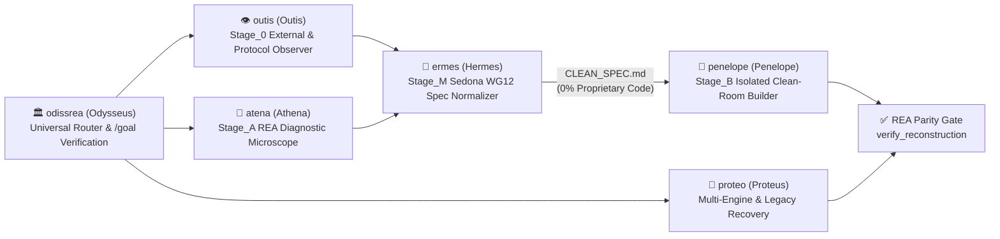

# 🏛️ OdissRea — Universal Clean-Room Specification & Reconstruction Suite for REA

> `FORMAT`: `ultracave` (high-density technical specification).
> `ENGINE`: [REA (Reverse Engineer Anything)](https://github.com/morluto/rea) — 207 MCP tools across Native, Managed, Mobile, Web/Electron, WASM/EVM, Firmware, Databases, and Network Protocols.
> `OPERATIONS MANUAL`: [MANUAL.md](MANUAL.md) — Digital Repair, Abandonware & The Anythink Principle in Caveman Ultra.

---

## 0. CORE PRINCIPLES [UNIVERSAL SYSTEMS ENGINEERING]
1. **FORMAL STATE-MACHINE MODEL**:
   - Any software or hardware artifact (ELF/PE/Mach-O binaries, .NET/Java/DEX bytecode, Electron/JS bundles, WASM/EVM modules, firmware images, SQLite databases, bus signals, and network captures) is a **deterministic mathematical state machine**:
     $$f(\text{input}, \text{state}) \longrightarrow (\text{output}, \text{state}')$$
   - Observing behavior, documenting interoperability interfaces, extracting data schemas, resolving legacy defects, and synthesizing a **100% original modern implementation** is standard systems engineering (EU Dir. 2009/24/EC Art. 1(2), 5(1) [*Top System* C-13/20], 5(3), 6, 8-9; CJEU *SAS Institute* C-406/10; 17 U.S.C. § 1201(f) & § 107; Sedona Conference WG12 Clean-Room Standard).
2. **PRECISION DIAGNOSTIC MICROSCOPE [ANTI-VIBE-CODE]**:
   - Superficial clones fail because they copy surface visuals while missing hidden domain invariants.
   - `OdissRea` uses the **207 REA tools** to uncover contextual branch conditions, exact arithmetic/reconciliation rules, multi-representation state identifiers, hardware/protocol framing, and legacy defects (`DO_NOT_REPLICATE`).

---

## 1. INSTALLATION
```bash
git clone https://github.com/mich-de/OdissRea.git /tmp/odissrea && /tmp/odissrea/install.sh && rm -rf /tmp/odissrea
```
Target directories: `~/.gemini/config/skills/`, `~/.claude/skills/`, `~/.config/opencode/skills/`.

---

## 2. THE ODISSREA PANTHEON [UNIVERSAL MULTI-AGENT ARCHITECTURE]



| Skill | Classical Archetype | Universal Engineering Scope |
|---|---|---|
| **[`odissrea`](skills/odissrea/SKILL.md)** | **Odysseus (*Polytropos*)** | Master Orchestrator, universal target router across all 207 REA tools, and iterative `/goal` verification coordinator. |
| **[`outis`](skills/outis/SKILL.md)** | **Outis (*External Observer*)** | `Stage_0` Black-Box Behavioral & Protocol Analyst (EU Art. 5.3 & *SAS Institute*): inspects HTTP/HAR/SAZ/PCAP, CLI/UI scenarios, SQLite schemas, and logic signals without decompilation. |
| **[`atena`](skills/atena/SKILL.md)** | **Athena (*Metis & Techne*)** | `Stage_A` REA Diagnostic Microscope: extracts hidden domain invariants, contextual edge-cases, data schemas, and formal obligation ledgers (`build_reconstruction_obligation_ledger`). |
| **[`ermes`](skills/ermes/SKILL.md)** | **Hermes (*Boundary Monitor*)** | `Stage_M` Sedona WG12 Specification Gate: normalizes `Stage_A` findings into a pure functional `CLEAN_SPEC.md` + timestamped `AUDIT_LOG` (`ev_...`) with zero proprietary code expression. |
| **[`penelope`](skills/penelope/SKILL.md)** | **Penelope (*The Weaver*)** | `Stage_B` Isolated Clean-Room Builder: consumes **only** `CLEAN_SPEC.md` to architect and test 100% original code (`Rust`, `Go`, `C23`, `Zig`, `Python`, `TS`, `Swift`, `Kotlin`, `UCI`, `libusb`). |
| **[`proteo`](skills/proteo/SKILL.md)** | **Proteus (*Multi-Engine*)** | Multi-Engine Adapter (`Ghidra` <-> `IDA` <-> `Hopper` <-> `Rizin` <-> `JEB` <-> `Frida` <-> `GDB` <-> `ADB`) & First-Party Legacy Source Recovery. |
| **[`itaca`](skills/itaca/SKILL.md)** | **Ithaca (*Homeland Hardware*)** | Legacy ARM, Mobile, SBC & PC Hardware Preservation: DTB/DTS reconstruction, vendor `.ko`/HAL interoperability, and mainline Linux/postmarketOS/LineageOS porting. |
| **[`ea`](skills/ea/SKILL.md)** | **Aeaea (*Transmutation Island*)** | First-Party Source Recovery & Cross-Language Transmutation: decompile and translate owned C/C++/ASM binaries into modern `Rust`, `Go`, `C23`, or `TypeScript`. |
| **[`ogigia`](skills/ogigia/SKILL.md)** | **Ogygia (*Orphaned Systems*)** | Abandonware, Database & Peripheral Rescue: recover SQLite schemas, crash dumps, proprietary archives, and synthesize user-space drivers (`libusb`/`hidapi`). |
| **[`eolia`](skills/eolia/SKILL.md)** | **Aeolia (*Winds & Flows*)** | Network Protocol, Packet (`PCAP`/`HAR`/`SAZ`/`qlog`) & Hardware Bus Signal (`UART`/`SPI`/`I2C`/`USB`) Interoperability Analysis. |
| **[`scheria`](skills/scheria/SKILL.md)** | **Scheria (*Phaeacian Port*)** | Mobile (`Android APK`/`DEX`/`Flutter`, `Apple IPA`/`Swift`), Managed (`.NET`), and `Electron`/`Web`/`WASM` Application Graph Modernization. |
| **[`t-800`](skills/t-800/SKILL.md)** | *Standalone Clean-Room* | All-in-One Tri-Stage Clean-Room Specification & Modernization Engine. |
| **[`eritrea`](skills/eritrea/SKILL.md)** | *Standalone Recovery* | All-in-One First-Party Legacy Source Recovery & Modernization Engine. |

---

## 3. UNIVERSAL TARGET COVERAGE [207 REA TOOLS]
- **Native Executables & Libraries (ELF / PE / Mach-O)**: `open_binary`, `binary_overview`, `inspect_binary_layout`, `batch_decompile`, `procedure_pseudo_code`, `get_call_graph`, `trace_call_path`, `trace_feature`, `trace_native_values`, `inspect_native_data_type`, `inspect_native_dispatch_metadata`.
- **Languages & Runtimes (Go / Rust / Swift / ObjC / .NET)**: `inspect_go_binary`, `inspect_rust_binary`, `analyze_swift_types`, `get_objc_classes`, `inspect_managed_artifact`, `inspect_managed_native_boundaries`, `project_managed_application_graph`.
- **Mobile & Packaged Apps (Android APK / DEX / JEB / Flutter / Harmony / Apple IPA)**: `inspect_android_package`, `search_android_classes`, `inspect_android_method`, `decompile_jeb_item`, `identify_flutter_build`, `inspect_dart_aot`, `project_android_application_graph`, `project_apple_application_graph`.
- **Web, Electron, WASM & EVM**: `analyze_javascript_application`, `recover_javascript_sources`, `trace_application_feature`, `trace_javascript_semantics`, `inspect_electron_fuses`, `inspect_wasm_artifact`, `compare_wasm_interfaces`, `inspect_evm_interface`.
- **Firmware, Hardware Buses, Databases & Captures**: `inspect_firmware_regions`, `extract_firmware`, `decode_signal_recording`, `inspect_sqlite_database`, `inspect_web_network_capture`, `inspect_pcap_capture`, `inspect_packet_capture`, `capture_process_scenario`, `capture_browser_scenario`, `capture_electron_scenario`.
- **Verification & Parity**: `build_reconstruction_obligation_ledger`, `evaluate_reconstruction_coverage`, `verify_reconstruction`, `compare_functions`, `compare_artifacts`, `compare_process_captures`.

---

## 4. REAL-WORLD USE CASES [ANYTHING PLAYBOOK — ULTRACAVE]

### CASE 1 :: ABANDONWARE ARM PHONE / TABLET / SBC -> MAINLINE LINUX (`itaca`)
- **Problem**: EoL ARMv7/AArch64 device stuck on ancient vendor kernel (Linux 3.4/3.10/4.4) or obsolete Android; vendor dropped support.
- **Pipeline**:
  1. `inspect_firmware_regions` -> `extract_firmware` (`boot.img`, `vendor.img`, `dtbo.img`, `super.img`).
  2. Extract `/sys/firmware/fdt` or `boot.img` DTB -> `dtc -I dtb -O dts -o board.dts`.
  3. `open_binary` on vendor `*.ko` & `hardware/*.so` -> `list_strings`, `batch_decompile`, `inspect_native_data_type` -> recover MMIO base addresses, `GIC` interrupts, `pinctrl` states, `regmap` sequences, PMIC voltage rails, MIPI-DSI panel timings.
  4. `list_adb_devices` -> `pull_adb_file` (`/proc/iomem`, `/proc/interrupts`, `/sys/kernel/debug/clk/clk_summary`, `/sys/kernel/debug/gpio`).
  5. `build_reconstruction_obligation_ledger` -> synthesize clean mainline `.dts`/`.dtsi`, U-Boot defconfig, `postmarketOS` APKBUILD or `LineageOS` device tree -> `verify_reconstruction`.

### CASE 2 :: ORPHANED USB / SERIAL PERIPHERAL -> USER-SPACE DRIVER (`ogigia` + `eolia`)
- **Problem**: Scientific instrument, scanner, audio interface, or industrial controller only has 32-bit Windows XP/7 `.sys` driver; hardware works, OS blocks unsigned/legacy kernel driver.
- **Pipeline**:
  1. `open_binary` on legacy `.sys`/`.dll` -> `list_procedures`, `find_xrefs_to_name` (`IoCallDriver`, `UsbBuildInterruptOrBulkTransferRequest`, `DeviceIoControl`).
  2. `procedure_pseudo_code` + `inspect_native_data_type` -> extract USB control transfers (`bmRequestType`, `bRequest`, `wValue`, `wIndex`), bulk endpoints, and command/response struct layouts.
  3. `decode_signal_recording` on USB/UART/SPI/I2C logic capture -> cross-check initialization handshake and timing invariants.
  4. Synthesize zero-kernel-dependency portable driver in `Rust` (`rusb`/`hidapi`), `C` (`libusb-1.0`), or `TypeScript` (`WebUSB`/`WebHID`) -> validate via `compare_process_captures`.

### CASE 3 :: LOST-SOURCE NATIVE DAEMON -> MEMORY-SAFE RUST / GO (`ea` + `proteo`)
- **Problem**: Critical first-party `ELF`/`PE`/`Mach-O` service or CLI tool has no surviving source repo; needs security hardening, ARM64 port, or bug fix.
- **Pipeline**:
  1. `open_binary`(`provider_id:"ghidra"|"ida"|"hopper"`) -> `binary_overview`, `get_call_graph`, `list_procedures`.
  2. `batch_decompile` + `inspect_native_data_type` + `inspect_native_dispatch_metadata` -> recover structs, enums, vtables, state machines, and lookup tables (`read_bytes`).
  3. Resolve indirect calls/unknowns via `record_unknown` -> `instrument_with_frida` / `start_gdb_session` -> `correlate_static_and_runtime` -> `update_unknown`.
  4. Translate into idiomatic `Rust`/`Go`/`C23`, compile (`caveman shrink -- cargo test`), and prove 1:1 parity via `compare_functions` + `verify_reconstruction`.

### CASE 4 :: LEGACY DESKTOP / SAAS APP -> CLEAN-ROOM RE-ARCHITECTURE (`outis` -> `atena` -> `ermes` -> `penelope`)
- **Problem**: Legacy bloated desktop/Electron/.NET/native suite needs a 100% original, high-performance modern replacement with zero IP contamination.
- **Pipeline**:
  1. **`outis` (`Stage_0`)**: `capture_process_scenario` / `capture_browser_scenario` + `inspect_sqlite_database`(`schema_scope:"database"`) + `inspect_web_network_capture` (`HAR`).
  2. **`atena` (`Stage_A`)**: Extract hidden domain invariants (contextual edge-case branches, exact decimal rounding/reconciliation rules, state-cleanup paths, legacy bugs tagged `DO_NOT_REPLICATE`) -> `build_reconstruction_obligation_ledger`.
  3. **`ermes` (`Stage_M`)**: Strip all proprietary symbols/code -> emit formal mathematical `CLEAN_SPEC.md` + timestamped `AUDIT_LOG` (`ev_...`).
  4. **`penelope` (`Stage_B`)**: Consume **only** `CLEAN_SPEC.md` -> weave clean modern codebase + property-based test suite -> verify `100%` ledger coverage via `evaluate_reconstruction_coverage`.

### CASE 5 :: EMBEDDED ROUTER / IOT APPLIANCE & LAN FIREWALL PROFILING (`itaca` + `eolia`)
- **Problem**: Constrained embedded router/appliance (e.g., 16 MB Flash / 128 MB RAM MIPS/ARM) needs custom OpenWrt firmware, RAM-backed DNS sinkhole, VPN client tunnel, and deterministic LAN device egress firewall rules.
- **Pipeline**:
  1. `inspect_firmware_regions` -> `extract_firmware` -> verify flash partition layout (`u-boot`, `factory` RF calibration, `firmware` SquashFS) and hardware offload path (`flow_offloading_hw`).
  2. `inspect_pcap_capture` -> `inspect_packet_fields` on appliance/LAN device traffic -> map exact DNS queries, SNI/endpoints, L4 ports, and keepalive intervals.
  3. Synthesize declarative `UCI` / `nftables` (`fw4`) configuration, tmpfs-backed `dnsmasq` blocklists, and `wireguard` policy routing -> verify zero flash wear and deterministic packet forwarding.

### CASE 6 :: MOBILE & CROSS-PLATFORM APP INTEROPERABILITY (`scheria`)
- **Problem**: Orphaned Android (`APK`/`DEX`/`Flutter`), iOS (`Mach-O`/`Swift`), or `.NET` client needs API/bridge recovery to keep working with self-hosted backend or modern OS.
- **Pipeline**:
  1. `project_android_application_graph` / `project_apple_application_graph` / `project_managed_application_graph`.
  2. `decompile_jeb_item` / `inspect_dart_aot` / `analyze_swift_types` / `inspect_managed_native_boundaries` -> map JNI/FFI/P-Invoke contracts, certificate pinning config, protobuf/JSON payloads, and local encrypted storage schemas.
  3. Build compatible self-hosted server or modernized client -> verify via `compare_artifacts` and `verify_reconstruction`.

---

## 5. LICENSE
MIT © [mich-de](https://github.com/mich-de)

