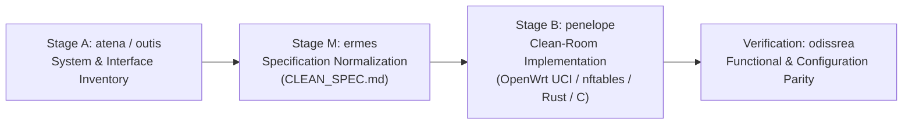

# OdissRea — Clean-Room Architecture & OpenWrt Embedded Engineering Reference

Reference documentation and modular skill definitions for **Clean-Room Software Specification (Sedona WG12)**, **Interoperability Analysis (EU Dir. 2009/24/EC)**, and **OpenWrt Embedded Network Appliance Design** using the [REA](https://github.com/morluto/rea) MCP toolset.

---

## 1. Architectural Overview

`OdissRea` structures software analysis and embedded system modernization into isolated, auditable stages:



| Module | Classical Reference | Engineering Scope |
|---|---|---|
| **[`odissrea`](skills/odissrea/SKILL.md)** | *Odysseus* | Project coordination, requirement tracking, and verification against hardware constraints. |
| **[`outis`](skills/outis/SKILL.md)** | *Outis* | External interface observation (EU Art. 5.3): HTTP/API schemas, SQLite schemas, and I/O behavior. |
| **[`atena`](skills/atena/SKILL.md)** | *Athena* | Stage A artifact inventory: package lists, flash partition layouts (`mtd`), and configuration schemas. |
| **[`ermes`](skills/ermes/SKILL.md)** | *Hermes* | Stage M normalization: produces hardware/software specifications (`CLEAN_SPEC.md`) free of proprietary code. |
| **[`penelope`](skills/penelope/SKILL.md)** | *Penelope* | Stage B clean-room synthesis: OpenWrt UCI configurations, `nftables` rulesets, and lightweight POSIX scripts. |
| **[`proteo`](skills/proteo/SKILL.md)** | *Proteus* | Multi-platform compatibility and user-space driver modernization (`libusb`, `hidapi`). |

---

## 2. Reference Blueprint: Constrained OpenWrt Home/Travel Appliance (16 MB Flash / 128 MB RAM)

For resource-constrained MIPS/ARM routers (e.g., MediaTek MT7628AN, 16 MB SPI NOR Flash, 128 MB RAM running OpenWrt 25.x), standard heavy stacks (such as full Pi-hole/Docker/SQLite) exceed flash and write-endurance limits. `OdissRea` defines three lightweight, standard OpenWrt functional profiles:

### A. RAM-Backed DNS Ad-Blocking & Local Resolver (Pi-hole Equivalent)
- **Packages**: `dnsmasq-full` (or standard `dnsmasq` with `addnhosts` / `conf-dir` in `/tmp/dnsmasq.d`), `adblock-fast` (or `adblock` + `luci-app-adblock`), `https-dns-proxy` + `luci-app-https-dns-proxy` (DNS-over-HTTPS upstream).
- **Flash Preservation**: Blocklists are downloaded and deduplicated exclusively in `tmpfs` (`/tmp/dnsmasq.d/`), utilizing ~8–15 MB of the 128 MB RAM with **zero SPI NOR flash wear**.

### B. WireGuard Site-to-Site / Road-Warrior Client (FRITZ!Box 7590 AX Gateway)
- **Packages**: `kmod-wireguard`, `wireguard-tools`, `luci-proto-wireguard`, `pbr` + `luci-app-pbr` (Policy-Based Routing).
- **Configuration**: Dedicated `wg0` interface in `/etc/config/network` peering with the home FRITZ!Box WireGuard endpoint (`AllowedIPs`, `PersistentKeepalive 25`), paired with a dedicated `vpn` firewall zone in `/etc/config/firewall` (`masq='1'`, `mtu_fix='1'`).

### C. Egress Firewall Rule Authoring via Router Telemetry (`conntrack` + DNS Logs)
To determine which external domains, IPs, and ports a specific LAN client (e.g., a smart TV, IoT appliance, or VoIP phone) requires in order to author restrictive egress firewall rules in `/etc/config/firewall`:
- **Mechanism**: Uses standard router-side connection tracking (`kmod-nf-conntrack`, `/proc/net/nf_conntrack` or `conntrack-tools`) and `dnsmasq` `log-queries` in RAM (`/tmp/dnsmasq.log`) filtered by the client's LAN IP.
- **Output**: Aggregates destination domains, protocols (`tcp`/`udp`), and destination ports (`443`, `8883`, `123`, etc.) to generate explicit `config rule` stanzas for OpenWrt `firewall4` (`nftables`).

---

## 3. Local Skill Installation
```bash
./install.sh
```

## 4. License
MIT © [mich-de](https://github.com/mich-de)
