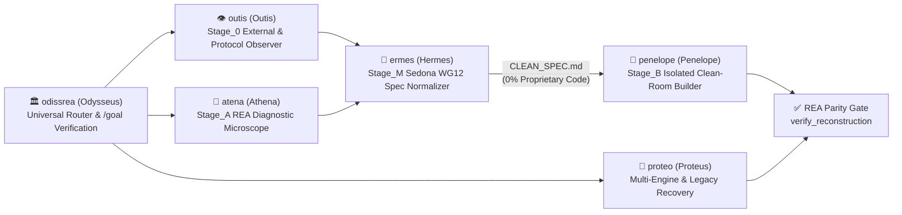

# 🏛️ OdissRea — Universal Clean-Room Specification & Reconstruction Suite for REA

> `FORMAT`: `ultracave` (high-density technical specification).
> `ENGINE`: [REA (Reverse Engineer Anything)](https://github.com/morluto/rea) — 207 MCP tools across Native, Managed, Mobile, Web/Electron, WASM/EVM, Firmware, Databases, and Network Protocols.

---

## 0. CORE PRINCIPLES [UNIVERSAL SYSTEMS ENGINEERING]
1. **FORMAL STATE-MACHINE MODEL**:
   - Any software or hardware artifact (ELF/PE/Mach-O binaries, .NET/Java/DEX bytecode, Electron/JS bundles, WASM/EVM modules, firmware images, SQLite databases, bus signals, and network captures) is a **deterministic mathematical state machine**:
     $$f(\text{input}, \text{state}) \longrightarrow (\text{output}, \text{state}')$$
   - Observing behavior, documenting interoperability interfaces, extracting data schemas, resolving legacy defects, and synthesizing a **100% original modern implementation** is standard systems engineering (EU Dir. 2009/24/EC Art. 1(2), 5(1) [*Top System* C-13/20], 5(3), 6, 8-9; CJEU *SAS Institute* C-406/10; 17 U.S.C. § 1201(f) & § 107; Sedona Conference WG12 Clean-Room Standard).
2. **PRECISION DIAGNOSTIC MICROSCOPE [ANTI-VIBE-CODE]**:
   - Superficial clones fail because they copy surface visuals while missing hidden domain invariants.
   - `OdissRea` uses the **207 REA tools** to uncover contextual branch conditions, exact arithmetic/reconciliation rules, multi-representation state identifiers, hardware/protocol framing, and legacy defects (`DO_NOT_REPLICATE`).

---

## 1. INSTALLATION
```bash
git clone https://github.com/mich-de/OdissRea.git /tmp/odissrea && /tmp/odissrea/install.sh && rm -rf /tmp/odissrea
```
Target directories: `~/.gemini/config/skills/`, `~/.claude/skills/`, `~/.config/opencode/skills/`.

---

## 2. THE ODISSREA PANTHEON [UNIVERSAL MULTI-AGENT ARCHITECTURE]



| Skill | Classical Archetype | Universal Engineering Scope |
|---|---|---|
| **[`odissrea`](skills/odissrea/SKILL.md)** | **Odysseus (*Polytropos*)** | Master Orchestrator, universal target router across all 207 REA tools, and iterative `/goal` verification coordinator. |
| **[`outis`](skills/outis/SKILL.md)** | **Outis (*External Observer*)** | `Stage_0` Black-Box Behavioral & Protocol Analyst (EU Art. 5.3 & *SAS Institute*): inspects HTTP/HAR/SAZ/PCAP, CLI/UI scenarios, SQLite schemas, and logic signals without decompilation. |
| **[`atena`](skills/atena/SKILL.md)** | **Athena (*Metis & Techne*)** | `Stage_A` REA Diagnostic Microscope: extracts hidden domain invariants, contextual edge-cases, data schemas, and formal obligation ledgers (`build_reconstruction_obligation_ledger`). |
| **[`ermes`](skills/ermes/SKILL.md)** | **Hermes (*Boundary Monitor*)** | `Stage_M` Sedona WG12 Specification Gate: normalizes `Stage_A` findings into a pure functional `CLEAN_SPEC.md` + timestamped `AUDIT_LOG` (`ev_...`) with zero proprietary code expression. |
| **[`penelope`](skills/penelope/SKILL.md)** | **Penelope (*The Weaver*)** | `Stage_B` Isolated Clean-Room Builder: consumes **only** `CLEAN_SPEC.md` to architect and test 100% original code (`Rust`, `Go`, `C23`, `Zig`, `Python`, `TS`, `Swift`, `Kotlin`, `UCI`, `libusb`). |
| **[`proteo`](skills/proteo/SKILL.md)** | **Proteus (*Multi-Engine*)** | Multi-Engine Adapter (`Ghidra` <-> `IDA` <-> `Hopper` <-> `Rizin` <-> `JEB` <-> `Frida` <-> `GDB` <-> `ADB`) & First-Party Legacy Source Recovery. |
| **[`itaca`](skills/itaca/SKILL.md)** | **Ithaca (*Hardware Preservation*)** | Legacy ARM, Mobile, SBC & PC Hardware Preservation: DTB/DTS reconstruction, vendor `.ko`/HAL interoperability, and mainline Linux/postmarketOS/LineageOS porting. |
| **[`t-800`](skills/t-800/SKILL.md)** | *Standalone Clean-Room* | All-in-One Tri-Stage Clean-Room Specification & Modernization Engine. |
| **[`eritrea`](skills/eritrea/SKILL.md)** | *Standalone Recovery* | All-in-One First-Party Legacy Source Recovery & Modernization Engine. |

---

## 3. UNIVERSAL TARGET COVERAGE [207 REA TOOLS]
- **Native Executables & Libraries (ELF / PE / Mach-O)**: `open_binary`, `binary_overview`, `inspect_binary_layout`, `batch_decompile`, `procedure_pseudo_code`, `get_call_graph`, `trace_call_path`, `trace_feature`, `trace_native_values`, `inspect_native_data_type`, `inspect_native_dispatch_metadata`.
- **Languages & Runtimes (Go / Rust / Swift / ObjC / .NET)**: `inspect_go_binary`, `inspect_rust_binary`, `analyze_swift_types`, `get_objc_classes`, `inspect_managed_artifact`, `inspect_managed_native_boundaries`, `project_managed_application_graph`.
- **Mobile & Packaged Apps (Android APK / DEX / JEB / Flutter / Harmony / Apple IPA)**: `inspect_android_package`, `search_android_classes`, `inspect_android_method`, `decompile_jeb_item`, `identify_flutter_build`, `inspect_dart_aot`, `project_android_application_graph`, `project_apple_application_graph`.
- **Web, Electron, WASM & EVM**: `analyze_javascript_application`, `recover_javascript_sources`, `trace_application_feature`, `trace_javascript_semantics`, `inspect_electron_fuses`, `inspect_wasm_artifact`, `compare_wasm_interfaces`, `inspect_evm_interface`.
- **Firmware, Hardware Buses, Databases & Captures**: `inspect_firmware_regions`, `extract_firmware`, `decode_signal_recording`, `inspect_sqlite_database`, `inspect_web_network_capture`, `inspect_pcap_capture`, `inspect_packet_capture`, `capture_process_scenario`, `capture_browser_scenario`, `capture_electron_scenario`.
- **Verification & Parity**: `build_reconstruction_obligation_ledger`, `evaluate_reconstruction_coverage`, `verify_reconstruction`, `compare_functions`, `compare_artifacts`, `compare_process_captures`.

---

## 4. LICENSE
MIT © [mich-de](https://github.com/mich-de)
